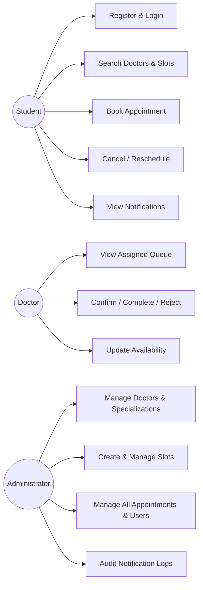
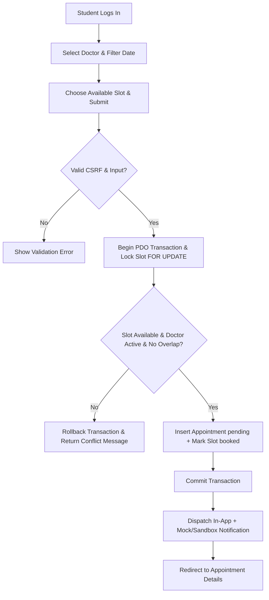
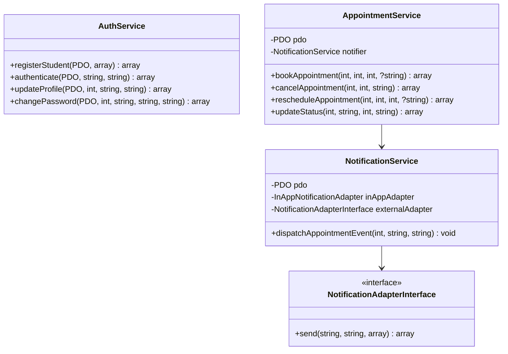
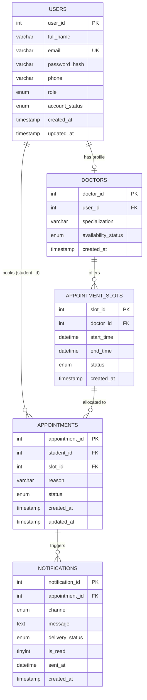

# Campus Clinic Appointment Management System (CCAMS)
## Complete Software Engineering Documentation — USTED University, Kumasi

---

## 1. Project Overview
The **Campus Clinic Appointment Management System (CCAMS)** is a web-based healthcare scheduling platform designed for **USTED University** (Tanoso Campus, Kumasi, Ghana). Built with PHP 8+, MySQL/MariaDB via PDO, HTML5, CSS3, Bootstrap 5, and JavaScript, CCAMS enables students to book, track, cancel, and reschedule clinic visits online while giving doctors and clinic administrators structured control over schedules and consultations.

---

## 2. Problem Statement
At USTED University's campus clinic, manual paper-based registration and walk-in queues create long waiting times, scheduling conflicts, missed consultations, and poor visibility into doctor availability. Students cannot easily verify which specialist is on duty before walking to the clinic, and clinic administrators lack real-time appointment metrics and notification logs.

---

## 3. Aim and Objectives
**Aim:** To design and implement a secure, responsive, and beginner-friendly Campus Clinic Appointment Management System for USTED University.

**Objectives:**
1. Provide online student registration, secure authentication, and role-based portals (Student, Doctor, Admin).
2. Enable real-time browsing of doctors, specializations, and open time slots.
3. Prevent double-booking race conditions using MySQL InnoDB transactions and row-level locking (`SELECT ... FOR UPDATE`).
4. Support clinic-rule-compliant appointment cancellation and rescheduling while preserving historical records.
5. Maintain an extensible notification architecture supporting in-app, mock, and SMS sandbox adapters.
6. Verify reliability and security through an automated PHPUnit integration suite and manual test plan.

---

## 4. Project Scope
- **In Scope:** Student registration/login, doctor and admin portals, doctor profile & specialization management, slot creation/editing/deactivation, atomic appointment booking, cancellation, rescheduling, search & filtering, in-app & mock/sandbox notifications, and automated PHPUnit tests.
- **Out of Scope:** Electronic Health Records (EHR), clinical diagnoses, laboratory/pharmacy inventory, and live paid telecom SMS billing. Only fictional demonstration data is used.

---

## 5. Stakeholder Analysis

| Stakeholder | Role / Interest | Key Needs |
| :--- | :--- | :--- |
| **USTED University Students** | Primary clinic patients | Fast booking, clear doctor availability, reminders, easy rescheduling |
| **Campus Clinic Doctors** | Medical practitioners | Organized daily queue, control over availability, appointment status updates |
| **Clinic Administrators** | Operations & staff coordinators | Doctor onboarding, slot creation, system-wide filtering, live metrics |
| **University Health Directorate** | Institutional sponsor | Reduced wait times, data integrity, student privacy protection |
| **5-Member Dev Team** | Academic builders & testers | Maintainable PHP/MySQL codebase, GitHub collaboration, clear documentation |

---

## 6. Functional Requirements
- **FR-1:** Students can register with full name, unique email, phone, and password; duplicate emails are rejected.
- **FR-2:** Users log in with email/password and are redirected to their role-specific dashboard.
- **FR-3:** Students can search doctors by name, filter by specialization, and filter open slots by date.
- **FR-4:** Students can book available slots atomically; occupied, past, or inactive slots are rejected.
- **FR-5:** Students can cancel or reschedule upcoming appointments outside the 2-hour cutoff window without deleting history.
- **FR-6:** Doctors can view only appointments assigned to them, filter by date/status, update statuses, and toggle availability.
- **FR-7:** Administrators can register/edit/activate/deactivate doctors, create/edit/deactivate slots, search/filter all appointments, manage user accounts, and inspect notification logs.
- **FR-8:** Every booking, cancellation, reschedule, and status change creates traceable notification records.

---

## 7. Non-Functional Requirements
- **Security:** `password_hash()`/`password_verify()`, PDO prepared statements, CSRF tokens, XSS escaping (`htmlspecialchars`), `HttpOnly`/`SameSite=Lax` session cookies, strict RBAC & ownership checks.
- **Reliability & Concurrency:** InnoDB ACID transactions with `FOR UPDATE` locking eliminate simultaneous double-bookings.
- **Usability & Responsiveness:** Clean blue/white/light-grey healthcare UI adapting seamlessly across desktop, tablet, and mobile viewports.
- **Maintainability:** Clear separation of configuration (`config/`), shared security/layout (`includes/`), business services (`services/`), and presentation pages.

---

## 8. Software Requirements Specification (SRS)
- **Server Runtime:** Apache 2.4+ with PHP 8.0+ (`pdo_mysql`, `curl`, `mbstring` extensions).
- **Database:** MySQL 8.0+ or MariaDB 10.4+ (`campus_clinic`, `utf8mb4` encoding, `InnoDB`).
- **Client Browser:** Modern evergreen browser (Chrome, Edge, Firefox, Safari) with JavaScript enabled for modal confirmations and mobile drawer navigation.

---

## 9. System Architecture
CCAMS follows a **3-Layer Modular Architecture** suited for beginner PHP developers:
1. **Presentation Layer:** Role-scoped PHP pages (`index.php`, `student/*`, `doctor/*`, `admin/*`) + shared Bootstrap 5/CSS/JS templates (`includes/header.php`, `includes/footer.php`).
2. **Service / Business Logic Layer:** `AuthService`, `AppointmentService`, and `NotificationService` encapsulating validation, transactions, row locks, and external notification adapters.
3. **Data Persistence Layer:** `config/database.php` (PDO singleton) communicating with MySQL `campus_clinic` tables.

---

## 10. Use Case Diagram

---

## 11. Activity Diagram (Appointment Booking Flow)

---

## 12. Class Diagram

---

## 13. Entity Relationship Diagram (ERD)

---

## 14. Database Dictionary (`campus_clinic`)

1. **`users`**: `user_id` (INT PK AI), `full_name` (VARCHAR 120), `email` (VARCHAR 150 UNIQUE), `password_hash` (VARCHAR 255), `phone` (VARCHAR 25 NULL), `role` (`student|doctor|admin`), `account_status` (`active|inactive`), `created_at`, `updated_at`.
2. **`doctors`**: `doctor_id` (INT PK AI), `user_id` (INT FK -> `users.user_id` UNIQUE), `specialization` (VARCHAR 120, indexed), `availability_status` (`available|unavailable`, indexed), `created_at`.
3. **`appointment_slots`**: `slot_id` (INT PK AI), `doctor_id` (INT FK -> `doctors.doctor_id`), `start_time` (DATETIME), `end_time` (DATETIME), `status` (`available|booked|inactive`), `created_at`. Composite indexes on `(doctor_id, start_time)` and `(status, start_time)`.
4. **`appointments`**: `appointment_id` (INT PK AI), `student_id` (INT FK -> `users.user_id`), `slot_id` (INT FK -> `appointment_slots.slot_id`), `reason` (VARCHAR 255 NULL), `status` (`pending|confirmed|cancelled|completed|rejected`), `created_at`, `updated_at`. Composite indexes on `(student_id, status)` and `(slot_id, status)`.
5. **`notifications`**: `notification_id` (INT PK AI), `appointment_id` (INT FK -> `appointments.appointment_id`), `channel` (`in_app|email|sms|mock`), `message` (TEXT), `delivery_status` (`pending|sent|simulated|queued|failed`), `is_read` (TINYINT 1), `sent_at` (DATETIME NULL), `created_at`.

---

## 15. User Interface Descriptions
- **Public Interface:** Top navigation bar, hero callout with live slot count, 4-step workflow guide, 6 campus healthcare service cards, featured USTED doctors, login & registration forms, and university footer.
- **Role Dashboards:** Fixed blue sidebar on desktop / slide-over drawer on mobile, sticky topbar with user avatar chip, 4-column metric cards populated by live SQL counts, filter bars, readable responsive tables, soft status pills, and Bootstrap confirmation modals.

---

## 16. Security Design
- Passwords hashed with `PASSWORD_DEFAULT` (`$2y$10$` bcrypt) and verified with `password_verify()`.
- Session ID regenerated via `session_regenerate_id(true)` upon login; cookies set with `httponly = true` and `samesite = Lax`.
- CSRF tokens generated via `random_bytes(32)` and checked via `hash_equals()` on every POST action.
- Output escaped via `htmlspecialchars(..., ENT_QUOTES | ENT_SUBSTITUTE, 'UTF-8')`.
- URL parameter IDOR prevented by scoping every query to the authenticated `student_id` or `doctor_id`.

---

## 17. Test Plan (16 Core Test Cases)

| ID | Test Description | Test Input | Expected Result | Actual Result | Status |
| :--- | :--- | :--- | :--- | :--- | :--- |
| **TC-01** | Student registration | Valid name, unique `@st.usted.edu.gh` email, phone, matching 8+ char passwords | Account created with `role='student'` and bcrypt hash | *[Pending local PHPUnit/XAMPP execution]* | Pending |
| **TC-02** | Duplicate email prevention | Existing registered email | Registration rejected with email validation error | *[Pending local PHPUnit/XAMPP execution]* | Pending |
| **TC-03** | Login with valid credentials | `kwabena.asare@st.usted.edu.gh` / `Student@2026` | Session created, ID regenerated, redirected to `student/dashboard.php` | *[Pending local PHPUnit/XAMPP execution]* | Pending |
| **TC-04** | Login with invalid credentials | Valid email + wrong password | Login rejected with generic error | *[Pending local PHPUnit/XAMPP execution]* | Pending |
| **TC-05** | Safe logout | POST `/logout.php` with valid CSRF | Session destroyed, redirected to `login.php` | *[Pending local PHPUnit/XAMPP execution]* | Pending |
| **TC-06** | Role-based access control | Student accesses `admin/dashboard.php` | Access denied, redirected to student dashboard | *[Pending local PHPUnit/XAMPP execution]* | Pending |
| **TC-07** | Doctor listing & filter | Search `"Mensah"`, filter `"General Medicine"` | Matching active doctors displayed | *[Pending local PHPUnit/XAMPP execution]* | Pending |
| **TC-08** | Slot availability display | Select doctor & future date | Only `available` future slots shown | *[Pending local PHPUnit/XAMPP execution]* | Pending |
| **TC-09** | Successful booking | Student books open slot | Appointment created (`pending`), slot set `booked` | *[Pending local PHPUnit/XAMPP execution]* | Pending |
| **TC-10** | Occupied slot rejection | Book already `booked` slot | Booking rejected with error message | *[Pending local PHPUnit/XAMPP execution]* | Pending |
| **TC-11** | Simultaneous booking safety | Two students target same `slot_id` | Row lock (`FOR UPDATE`) allows first, blocks second | *[Pending local PHPUnit/XAMPP execution]* | Pending |
| **TC-12** | Appointment cancellation | Student cancels eligible booking | Appointment set `cancelled`, record kept, future slot freed | *[Pending local PHPUnit/XAMPP execution]* | Pending |
| **TC-13** | Appointment rescheduling | Student moves booking to new open slot | Old record kept `cancelled`, old slot freed, new appointment created | *[Pending local PHPUnit/XAMPP execution]* | Pending |
| **TC-14** | Doctor appointment management | Doctor confirms/completes assigned visit; wrong doctor blocked | Assigned doctor succeeds; other doctor denied | *[Pending local PHPUnit/XAMPP execution]* | Pending |
| **TC-15** | Administrator permissions | Admin adds doctor, creates slot, toggles user | Operations succeed for admin only | *[Pending local PHPUnit/XAMPP execution]* | Pending |
| **TC-16** | Notification record generation | Any book/cancel/reschedule/status update | `in_app` (`sent`) and `mock`/`sms` records inserted | *[Pending local PHPUnit/XAMPP execution]* | Pending |

---

## 18. Test Results
> **Execution Transparency Notice:** In the code-generation environment where this repository was authored, PHP (`php`), MySQL (`mysql`), and PHPUnit binaries were not installed (`php: not found`, `mysql: not found`). Therefore, no automated or manual runtime test execution is claimed as having passed yet. All 16 test scenarios are implemented in `tests/CCAMSIntegrationTest.php` and ready for execution on XAMPP via `vendor/bin/phpunit` once `database/campus_clinic.sql` is imported.

---

## 19. Risk Register

| Risk | Likelihood | Impact | Mitigation |
| :--- | :--- | :--- | :--- |
| Concurrent booking race condition | Medium | High | `InnoDB` transactions + `SELECT ... FOR UPDATE` slot row lock |
| SQL Injection / XSS attacks | Medium | High | Strict PDO prepared statements (`EMULATE_PREPARES=false`) & `e()` escaping |
| Unauthorized cross-user access (IDOR) | Medium | High | Server-side session role checks & ownership filters in SQL `WHERE` clauses |
| Lost history after cancellation | Low | Medium | Soft-status updates (`cancelled`) instead of `DELETE` statements |
| Accidental credential upload to GitHub | Medium | High | `.gitignore` excludes `config/database.local.php` and `.env` |

---

## 20. Eight-Week Sprint Plans (5-Member Team)

- **Week 1 (Sprint 1):** Requirements gathering, GitHub setup (Member 1), ERD & `campus_clinic.sql` schema (Member 3).
- **Week 2 (Sprint 2):** `config/database.php`, shared `header.php`/`footer.php`, `style.css`, public pages (Members 2 & 4).
- **Week 3 (Sprint 3):** Student registration, login, logout, CSRF, RBAC (`AuthService`, `auth.php`) (Member 2).
- **Week 4 (Sprint 4):** Role-based dashboards (Student, Doctor, Admin) with live SQL metrics (Members 2 & 4).
- **Week 5 (Sprint 5):** Doctor onboarding, editing, and slot management (`admin/*`) (Members 3 & 4).
- **Week 6 (Sprint 6):** Transactional booking, cancellation, rescheduling (`AppointmentService`) (Member 3).
- **Week 7 (Sprint 7):** Decoupled `NotificationService` (in-app, mock, SMS sandbox) & search/filtering (Member 5).
- **Week 8 (Sprint 8):** PHPUnit suite execution on XAMPP, bug fixing, final documentation & presentation prep (All 5 members).

---

## 21. Installation Instructions
See [`docs/INSTALLATION_GUIDE.md`](INSTALLATION_GUIDE.md) for complete XAMPP, phpMyAdmin, Composer, and PHPUnit setup steps.

---

## 22. User Guide
- **Students:** Register at `register.php` -> Log in -> Browse `student/doctors.php` -> Book a slot in `student/book_appointment.php` -> Manage, cancel, or reschedule in `student/my_appointments.php` -> Check alerts in `student/notifications.php`.
- **Doctors:** Log in -> Review daily queue in `doctor/dashboard.php` -> Confirm/Complete/Reject visits in `doctor/my_appointments.php` -> Set availability in `doctor/profile.php`.
- **Administrators:** Log in -> Monitor KPIs in `admin/dashboard.php` -> Add/edit doctors in `admin/manage_doctors.php` -> Create/manage time slots in `admin/manage_slots.php` -> Filter all visits in `admin/manage_appointments.php`.
